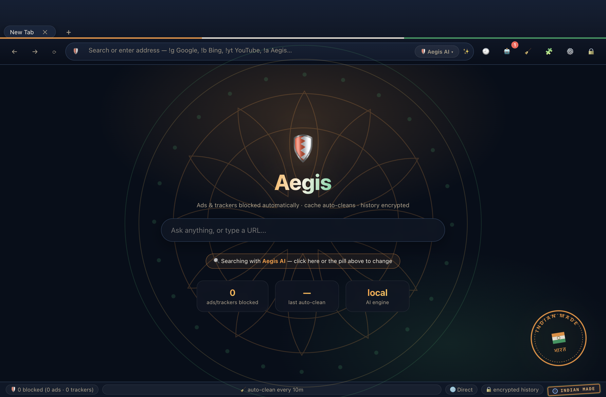

# 🛡️ Aegis AI Browser

A privacy-first, AI-automated desktop browser built on Electron/Chromium — with an Indian-themed interface. **Free and open source (MIT).**



## Download

Grab the latest build from **[Releases](https://github.com/moulitholusuri/aegis-ai-browser/releases)** — free, no account needed.

| Platform | File | Notes |
|---|---|---|
| macOS (Apple Silicon) | `Aegis-*-mac-arm64.dmg` | Unsigned build: right-click the app → **Open** the first time (or `xattr -dr com.apple.quarantine /Applications/Aegis.app`). |
| macOS (Intel) | `Aegis-*-mac-x64.dmg` | Built by CI on each tag. Same unsigned caveat. |
| Windows | `Aegis-*-win-x64.exe` | SmartScreen may warn: **More info → Run anyway**. |
| Linux | `Aegis-*-linux-x86_64.AppImage` | `chmod +x` then run. |

Signing/notarization is intentionally skipped so the project stays free to build and distribute. Drop a ⭐ if you find it useful.

## Features

| Requirement | How it's implemented |
|---|---|
| **First-party AI search engine** | Aegis does **not** use Google/Bing/DuckDuckGo directly. Every query hits `aegis://search` — a built-in metasearch that fans out to 7 independent sources in parallel (DuckDuckGo web+facts, Wikipedia, Stack Overflow, GitHub, arXiv, Hacker News), dedupes, then ranks locally with BM25 + query-intent detection (definition / how-to / comparison / news / code / research), source-authority priors, freshness decay and log-damped quality signals. Results stream in as each source responds; an AI answer box sits on top (on-device local synthesis by default, cloud LLM with inline citations if configured), and the cloud LLM can re-rank the head of the list. A 10-min LRU cache makes repeat queries instant. No ads, no tracking, no query logging. |
| **Fully automated AI browser** | Built-in AI copilot: page summaries, Q&A about any page, and an **Autopilot agent** that decomposes a task into steps (open/ask/done) and runs them for you. Uses an OpenAI-compatible API if you configure one, otherwise a fully-offline local engine. |
| **Ignores all ads** | Request-layer blocking of 120+ ad/tracker/malvertising domains + URL-pattern rules, plus **cosmetic filtering** that hides ad containers served from first-party origins (Google AdSense, Taboola, Outbrain, sponsored posts, cookie banners…). Live blocked counter in the status bar. |
| **Auto-clears cache & informs you** | Automatically flushes HTTP cache, cookies, and site storage on a schedule (5/10/30/60 min, configurable). Every clean raises a **system notification + in-app toast** with what was removed. Also cleans on quit and has a one-click "Clean now" button. |
| **Google Authenticator sign-in** | True **TOTP (RFC 6238)** — the exact standard Google Authenticator uses. First run shows a QR code to scan; every sign-in needs your passphrase **plus** the live 6-digit code. Passphrase is stretched with **scrypt**; codes verified with ±1 step clock-drift tolerance. |
| **Protected history** | Browsing history is encrypted **at rest with AES-256-GCM** — plaintext never touches the disk. The encryption key is derived from your passphrase + authenticator secret and only exists in memory while unlocked. Auto-locks after inactivity. Searchable, deletable, clearable history panel. |
| **Leak-proof** | WebRTC IP-leak prevention, cross-site referrer stripping, DNT + Global Privacy Control headers forced on, anti-fingerprinting (WebGL spoofing, webdriver hiding, battery/bluetooth neutralized), all permissions denied by default, dangerous URL schemes blocked, background networking & component updates disabled, certificate errors surfaced. |

## Run it

```bash
cd aegis-browser
npm install   # already done
npm start
```

## First run

1. **Choose a passphrase** (min 8 chars) → click *Create authenticator binding*.
2. **Scan the QR code** with Google Authenticator (or any TOTP app: Authy, 1Password, Aegis…).
   - Can't scan? Enter the displayed key manually in your app.
3. **Type the 6-digit code** → *Activate browser*.
4. You're in. The 🧹 status bar shows the auto-clean schedule, 🛡️ shows live ad blocking.

## Daily use

- **Omnibox** — type a URL (`example.com`), a search (`search …`), or a question
  (`what is WebRTC leakage?`) — the intent router picks the right action.
- **🤖 AI panel** (⌘-button in toolbar) — *Summarize this page*, *Ask*, or run an
  **Autopilot** task like *"find the latest news on AI privacy"* and watch the agent work.
- **🧹** — clean cache/cookies instantly. **🔒** — lock the vault.
- **Settings ⚙️** — auto-clean interval, auto-lock timeout, anti-fingerprint toggles,
  and optional AI provider (API key is stored **encrypted in your vault**).

## Aegis Search — the built-in engine

Type anything in the omnibox that isn't a URL and it goes to `aegis://search?q=…`,
never to an external search engine.

**Pipeline** (per query):

```
query ──► parallel fan-out to 7 sources (each AbortSignal-timed, isolated)
      ──► URL-normalize + dedupe (utm/fragment stripping, title dedupe)
      ──► local rank: BM25(title×2 + snippet) × intent-boost × authority × freshness × quality
      ──► optional AI re-rank (top 15 re-ordered by your LLM, output validated)
      ──► answer synthesis (cloud LLM w/ [n] citations | local instant-answer + snippet stitch)
      ──► streamed to the results page as NDJSON events + cached 10 min (LRU)
```

**Intent-aware ranking** — the engine classifies your query
(definition / howto / comparison / news / code / research / commercial) and
re-weights sources accordingly: Wikipedia wins definitions, Stack Overflow and
GitHub win code queries, arXiv wins research, Hacker News wins news/discussion.
Freshness half-life is intent-specific (36 h for news, years for definitions).

**Performance guards**: every source has its own timeout so one dead endpoint
never stalls the page (results paint progressively as sources land); the
local ranker is O(results) microseconds; hot queries are cache-served in <20 ms.
Verified: 28 ranked results across 6 live sources in ~2 s, cache hit <20 ms
(`node scripts/test-search.js`).

**Privacy**: queries are never logged, results carry no ads or tracking, and
search pages are first-party (`aegis://`) so no external engine sees your terms
beyond the sources actually fetched.

## Architecture

```
src/
  main/
    main.js         # Electron main: window, WebContentsView tabs, IPC
    auth.js         # TOTP enrollment + two-factor sign-in (scrypt + AES-GCM)
    crypto-utils.js # RFC 6238 TOTP, base32, scrypt KDF, AES-256-GCM
    vault.js        # Encrypted-at-rest history + secrets store
    blocklist.js    # Ad/tracker request blocking, header hygiene, anti-fingerprint
    privacy.js      # Auto-clean scheduler, notifications, purge-on-quit
    ai.js           # AI engine: cloud LLM or offline local summarizer/agent
  preload.js        # contextBridge API (no node integration in renderer)
  renderer/         # Browser chrome, AI copilot, history & settings UI
```

**Security posture:** the renderer is fully sandboxed (`contextIsolation`, `sandbox`,
no `nodeIntegration`, no `webviewTag`); it only talks to the main process through a
minimal `contextBridge` API. Page content runs in isolated `WebContentsView`s with
their own hardened session partition.

> ⚠️ This is a working security-focused browser, not a substitute for a audited
> product (e.g. Tor/Arc). Protect your passphrase — it is the only way to recover
> your encrypted history. There is deliberately **no password reset**.
